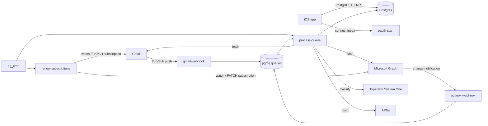

## OpportuniTrack - Track Your Next Opportunity, Effortlessly.

OpportuniTrack is an automated job application tracker using email.

Job hunt is exhausting (especially in this market!), and it's essential to keep track of hundreds of applications you submit everyday.

OpportuniTrack saves hours of manual work of keeping track of job applications everyday by automating it using your email

## Features

-   Track applications automatically by connecting your Gmail or Outlook inbox
-   Get notified whenever there is an update on your application
-   Add or edit applications manually
-   More features coming soon!

## Architecture

The backend runs entirely on Supabase: Postgres (with Row Level Security), Auth, Vault for OAuth tokens, Edge Functions, and pgmq / pg_cron / pg_net for background work. There are no separate servers.



```
supabase/
  config.toml            Edge Function settings
  migrations/            schema, RLS, Vault token RPCs, queues and cron jobs
  functions/
    _shared/             providers (Gmail, Graph), classifier, pipeline, queue worker, APNs
    <function>/index.ts  one directory per Edge Function
    tests/               deno tests with in-memory fakes
```

Development:

```bash
cd supabase/functions
deno task test     # unit tests
deno task check    # type-check every function
deno lint
```

Deploying needs the Supabase CLI and the secrets listed in `supabase/functions/.env.example`:

```bash
supabase link --project-ref <ref>
supabase db push
supabase secrets set --env-file supabase/functions/.env
supabase functions deploy
```

## Note

-   OpportuniTrack connects to Gmail and Outlook directly with read-only OAuth access. Tokens are encrypted in Supabase Vault.
-   Emails are screened by sender and subject first; only likely job-related emails are sent to the classifier (TypeSafe System One) to extract company, role and status.
-   We don't store your email in our database, we only extract job application related information and store it
